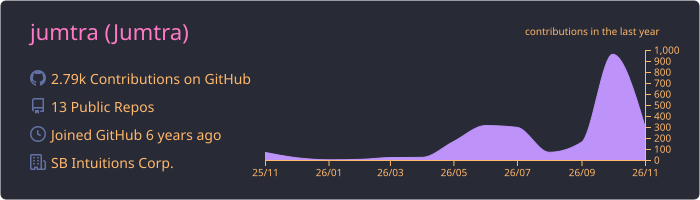
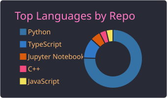
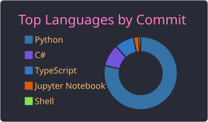
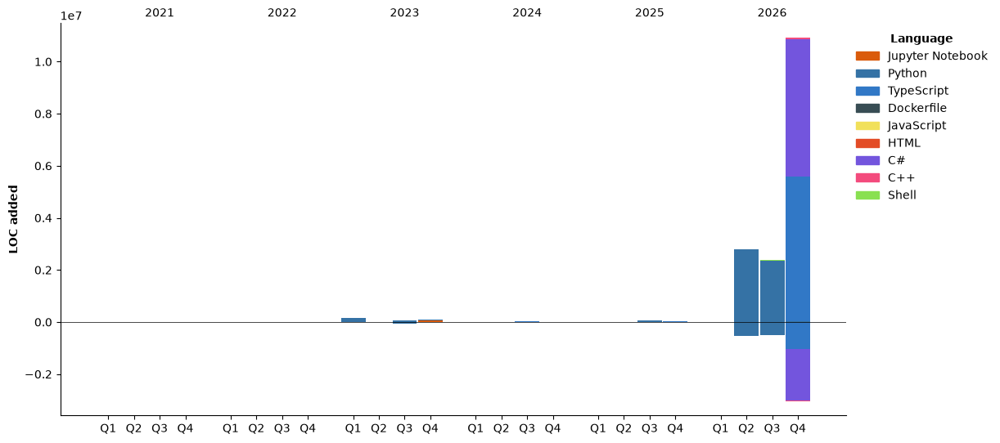

### 👋 Hi! I'm jumtra
<p align="left"> 
  <a href="https://github.com/jumtra/jumtra/">
    
  </a>
  <a href="http://twitter.com/Jumtra1">
    
  </a>
  <a href="https://github.com/jumtra">
    
  </a>
  <a href="http://qiita.com/Jumtra">
    
  </a>
  <a href="http://qiita.com/Jumtra">
    
  </a>
</p>

<p align="left"> 
  
  
</p>

[](https://github.com/ryo-ma/github-profile-trophy)
[](https://github.com/vn7n24fzkq/github-profile-summary-cards)
[](https://github.com/vn7n24fzkq/github-profile-summary-cards)
[](https://github.com/vn7n24fzkq/github-profile-summary-cards)


#### Development Environment

- Favorite Languages: Python3
- OS: Windows10,Ubuntu20.04
- CPU: Rythen7 3700X
- GPU: GEFORCE RTX2070 SUPER
- MEMORY: 32GB

#### Analysis
<details>
  <summary>Other Statics</summary>
<!--START_SECTION:waka-->


**🐱 My GitHub Data** 

> 📦 1.2 MB Used in GitHub's Storage 
 > 
> 🏆 30 Contributions in the Year 2026
 > 
> 💼 Opted to Hire
 > 
> 📜 15 Public Repositories 
 > 
> 🔑 46 Private Repositories 
 > 
**I'm an Early 🐤** 

```text
🌞 Morning                6218 commits        ██████░░░░░░░░░░░░░░░░░░░   24.29 % 
🌆 Daytime                8820 commits        █████████░░░░░░░░░░░░░░░░   34.46 % 
🌃 Evening                9014 commits        █████████░░░░░░░░░░░░░░░░   35.22 % 
🌙 Night                  1542 commits        ██░░░░░░░░░░░░░░░░░░░░░░░   06.02 % 
```
📅 **I'm Most Productive on Wednesday** 

```text
Monday                   2731 commits        ███░░░░░░░░░░░░░░░░░░░░░░   10.67 % 
Tuesday                  3130 commits        ███░░░░░░░░░░░░░░░░░░░░░░   12.23 % 
Wednesday                5911 commits        ██████░░░░░░░░░░░░░░░░░░░   23.10 % 
Thursday                 4712 commits        █████░░░░░░░░░░░░░░░░░░░░   18.41 % 
Friday                   3160 commits        ███░░░░░░░░░░░░░░░░░░░░░░   12.35 % 
Saturday                 2936 commits        ███░░░░░░░░░░░░░░░░░░░░░░   11.47 % 
Sunday                   3014 commits        ███░░░░░░░░░░░░░░░░░░░░░░   11.78 % 
```


📊 **This Week I Spent My Time On** 

```text
🕑︎ Time Zone: Asia/Tokyo

💬 Programming Languages: 
No Activity Tracked This Week

🔥 Editors: 
No Activity Tracked This Week

🐱‍💻 Projects: 
No Activity Tracked This Week

💻 Operating System: 
No Activity Tracked This Week
```

🤖 **AI Coding This Week** 

```text
No AI Coding Activity Tracked This Week
```

**I Mostly Code in Python** 

```text
Python                   51 repos            █████████████████░░░░░░░░   69.86 % 
TypeScript               7 repos             ██░░░░░░░░░░░░░░░░░░░░░░░   09.59 % 
C#                       2 repos             █░░░░░░░░░░░░░░░░░░░░░░░░   02.74 % 
C++                      2 repos             █░░░░░░░░░░░░░░░░░░░░░░░░   02.74 % 
Shell                    1 repo              ░░░░░░░░░░░░░░░░░░░░░░░░░   01.37 % 
```


**Timeline**




 Last Updated on 31/10/2026 22:46:47 UTC
<!--END_SECTION:waka-->
 </details>
